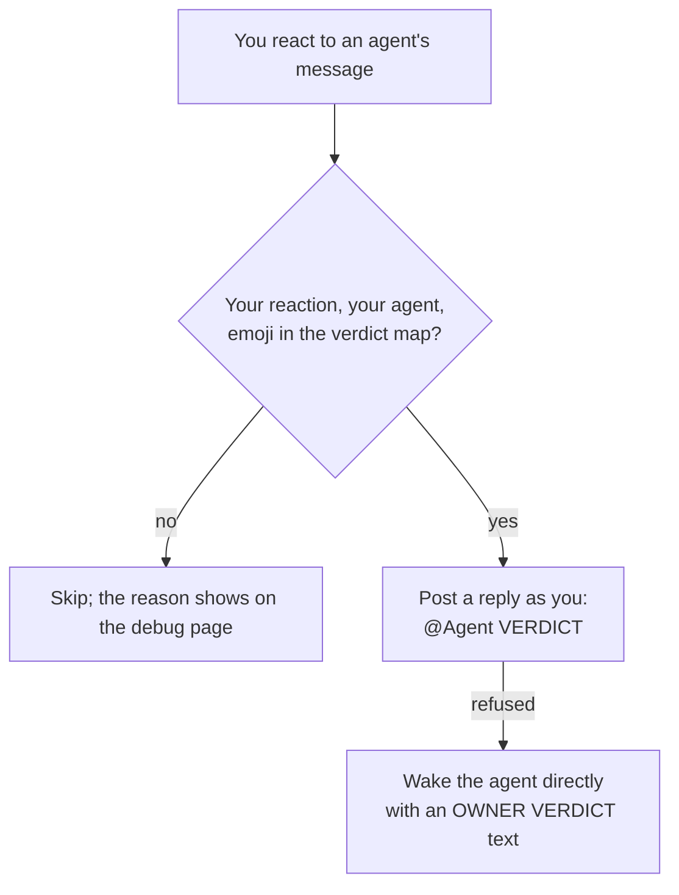

# Reaction verdicts for Buzz

A Buzz desktop plugin. React to a message of one of your agents, and the
agent gets your verdict. By default:

| Reaction | Verdict | Meaning sent to the agent |
| --- | --- | --- |
| 👍 or `+` | `APPROVED` | The owner approves the request in that message. |
| 👎 or `-` | `REJECTED` | The owner rejects the request in that message. |
| ❓ or ❔ | `CLARIFY` | Explain that message again, simpler, with the missing context. |
| 💾 | `SAVE_LEARNINGS` | Save the learnings from this conversation to your memory. |
| 🔍 or 🔎 | `VERIFY` | Check the claims of that message again with evidence. |

You can change the emoji and the verdicts in Settings. Skin tones do not
matter: 👍🏽 counts as 👍.

## How it works



1. The plugin listens to live reactions on the relay. It ignores replays, so
   an old reaction never wakes an agent again.
2. Only your own reactions count, and only on messages by agents that you own.
3. The plugin posts one message as you that mentions the agent. A real
   mention wakes the agent through the normal path, so Buzz shows its usual
   "working" feedback.
4. If Buzz refuses that message (for example, the agent left the channel),
   the plugin wakes the agent directly instead.

## The verdict contract for your agents

The plugin only delivers the verdict. Each agent must know what to do with
it, so add a rule like the one below to your agents' instructions. Without
such a rule, an agent sees an ordinary mention and may not act on it.

| Where | What the agent receives |
| --- | --- |
| Thread | A reply from you: `@Agent APPROVED`. Its NIP-10 `reply` tag names the judged message. |
| Solo chat | A message from you: `@Agent APPROVED for your message <id>`. |
| Fallback wake | Text that starts with `OWNER VERDICT: APPROVED.`, then the meaning, the judged message id and a short excerpt. |

Example rule for an agent:

```text
When your owner replies to one of your messages with "@<your name> <VERDICT>",
or a wake starts with "OWNER VERDICT: <VERDICT>", the verdict applies only to
the message it names. APPROVED: continue with the request. REJECTED: stop and
say what you stopped. CLARIFY: explain the message again, simpler. VERIFY:
check its claims again with evidence. SAVE_LEARNINGS: save the durable
learnings of the conversation. If the message has no clear request, ask.
```

If you add your own verdict names, add them to this rule too.

## Install

Plugins run only in the Buzz desktop app.

- **From Git:** Settings > Plugins > Manage plugins > Add. Enter the
  repository `https://github.com/sagmans/buzz-plugin-reaction-verdicts.git`
  and the branch `main` (or a release tag), then select the `plugin` folder.
- **From a link:** open
  `buzz://plugin-install?repository=sagmans%2Fbuzz-plugin-reaction-verdicts&ref=main`.
- **From a folder:** clone this repository, then Settings > Plugins > Manage
  plugins > Load from folder, and select its `plugin` folder.

Review the access the install dialog shows, install, then enable the plugin.
New plugins start disabled.

## Configuration

Open Settings > Plugins > Reaction verdicts. Write one rule per line:

```text
<reaction> <VERDICT> [meaning]
```

- `reaction`: an emoji or a short text, such as `+` or `:ship:`, with no
  spaces; at most 32 characters.
- `VERDICT`: capitals, digits and `_` (`A-Z`, `0-9`, `_`), at most 32
  characters. The plugin posts it after the mention.
- `meaning`: optional, one sentence that tells the agent what the verdict
  means. The fallback wake quotes it. The first meaning given for a verdict
  is used.
- Blank lines and lines that start with `#` are ignored. A reaction can have
  only one verdict. At most 32 rules.

Example:

```text
# Team map
🚀 SHIP Ship the change now.
👍 LGTM
👎 REJECTED The owner rejects the request in that message.
```

Select **Save**. New reactions use the new map at once. **Reset to
defaults** restores the table at the top of this page.

The map is stored on this computer only, in the app's local storage, under
the key `sagmans.reaction-verdicts.verdict-map.v1`. If the saved map is
damaged, no reaction counts until you fix it or reset it (fail closed). The
settings card and the debug page then show the problem.

## Mobile and other clients

- The mobile app runs no plugins. Reactions that you send from mobile still
  count, because the desktop app sees them on the relay. The desktop app must
  be open and signed in as you.
- Mobile reactions have no channel tag. The plugin takes the channel from the
  judged message's own signed tag.
- Run the plugin in one desktop app per account. Each running copy posts its
  own verdict message.

## Debug page

The plugin has a page, "Reaction verdicts", with the last 30 events and the
reason for each skip. It is not in the sidebar; find it with the app's search.
The log is kept in memory and resets on restart.

## Security

- Buzz plugins are not sandboxed. They run in the app with its full power.
  Install only code that you trust and have reviewed.
- This plugin requests no host access: no commands, files or network origins.
  It uses the Buzz services `react`, `pages`, `relay`, `agents` and,
  optionally, `settingsCards`.
- It publishes only one message per verdict reaction, as you, in the
  conversation of the judged message. It acts only on your own signed
  reactions on messages by agents that you own. When a reaction names a
  channel, it must be the channel of the judged message.
- The verdict map is validated when it is saved and when it is loaded.
  Verdict names cannot add mentions, links or new lines to the message.
- Local storage is not secret. Other plugins can read and change it, so the
  map holds no secrets. A changed map that fails validation stops all
  verdicts instead of using unexpected text.

## Development

The plugin is plain JavaScript (`plugin/plugin.js`, `plugin/manifest.json`)
with no build step and no dependencies. Buzz loads the `plugin` folder as is.

After you clone, turn on the git hooks once:

```sh
scripts/setup-hooks
```

The hooks need these tools on your `PATH`: `gitleaks`, `node` (20 or newer),
`shellcheck`, `shfmt`, `markdownlint-cli2`, `semgrep`, `trivy`, `lizard`,
`osv-scanner`, `actionlint` and `zizmor`. A missing tool blocks the commit or
push that needs it. Every check must pass before you push. Never use
`--no-verify`.

Run the checks by hand:

```sh
scripts/check                 # offline: js, shell, markdown, personal-data, dogfood
scripts/check semgrep trivy   # network scanners
node scripts/dogfood.mjs      # the plugin with a fake Buzz host
```

Commit messages follow `.githooks/GIT_CONVENTION.md`, with a DCO sign-off
(`git commit -s`).

## License

Apache License 2.0. See [LICENSE](LICENSE).
